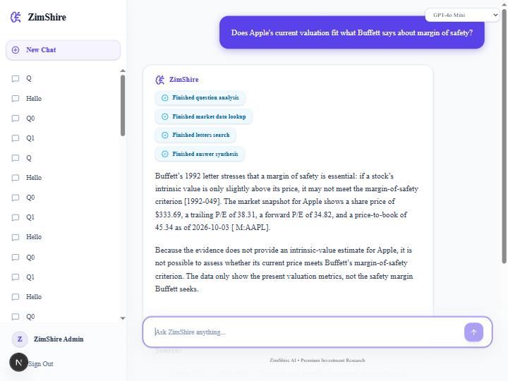

# Connecting the ZimShire frontend

The chat UI lives in a separate public repository, [allebee/zimshire-frontend](https://github.com/allebee/zimshire-frontend)
(Next.js 16, NextAuth, streaming chat, history sidebar, thumbs feedback). It was written for a different backend, so
Buffett-Lens adds a thin **compatibility layer** (`app/api/compat.py`) instead of changing the frontend repository.
The frontend repository is not modified.



## Run it

```bash
# 1. Backend (from this repository). .env must contain API_KEY=zimshire-dev-secret (it is in .env.example)
docker compose up --build -d

# 2. Frontend (a sibling folder, cloned from the repository above)
git clone https://github.com/allebee/zimshire-frontend.git ../zimshire-frontend
cd ../zimshire-frontend
npm install
```

Create `../zimshire-frontend/.env.local` (git-ignored by the frontend repository):

```env
BACKEND_API_KEY=zimshire-dev-secret      # must equal API_KEY of this backend
NEXTAUTH_SECRET=<any random string>
NEXTAUTH_URL=http://localhost:3001
```

```bash
npm run dev -- --port 3001               # 3001, because Langfuse already uses 3000
```

Open http://localhost:3001 and sign in with the frontend's mock user (`admin` / `zimshire`, defined in its `src/lib/auth.ts`).

The frontend has the backend address `http://localhost:8000` hard-coded in each `src/app/api/*/route.ts`, which matches
this backend's port. CORS is **not needed**: the browser only talks to the Next.js server, and the Next.js server
calls this backend server-to-server (that is also where the API key is added, so it never reaches the browser).

## What the frontend expects and how it is provided

| Frontend calls | Handled by |
|---|---|
| `POST /v1/chat/completions` (OpenAI-style request, `x-api-key`, streaming) | `app/api/compat.py` -> the same LangGraph agent graph as `/v1/chat` |
| Stream: `metadata`, `status`, OpenAI `delta.content` chunks, `[DONE]` | graph steps become status badges; the validated answer is streamed in small chunks |
| `GET /v1/conversations`, `GET /v1/conversations/{id}` | existing endpoints; messages now carry an `id` |
| `DELETE /v1/conversations/{id}` | new: removes messages and the saved graph state |
| `POST /v1/feedback?message_id&rating&user_id` | new: `feedback` table, one row per message and user, can be changed |
| `x-api-key` header | `app/api/auth.py`, enforced on **all** `/v1` routes when `API_KEY` is set |
| Model dropdown (`gpt-4o-mini`, `claude-sonnet-4-6`, ...) | `MODEL_ALIASES` in `app/config.py`: small names map to `gpt-oss-20b`, large to `gpt-oss-120b`; unknown names pass through unchanged |

Status badges: the frontend prints "Running <text>..." and "Finished <text>", so the backend sends nouns:
`question analysis`, `letters search`, `market data lookup`, `web search`, `answer synthesis`.
Sources: the frontend has no field for them and renders Markdown, so the answer ends with a `**Sources**` list
(letter year and id with a short quotation, market data id, web links). That same text is what gets stored in the history.

## Limitations

- **No per-user isolation.** The frontend has one mock user and asks for the conversation list without a `user_id`,
  so every user would see every conversation. The backend stores `user_id` with each conversation, but cannot filter by it
  until the frontend sends it with the list request.
- **Feedback ids.** For a message that has just been streamed the frontend sends its own client-side id, not the database id,
  so the rating is stored under that id and cannot be joined to the `messages` table. Messages restored from history have
  database ids and do match.
- **Errors inside a stream** are shown as text in the answer (prefixed with a warning sign), because the frontend only
  shows a toast for failed HTTP requests.
- **The answer streams after validation** (see "Streaming" in the README), so the first word appears after the whole
  pipeline has finished; the status badges show progress meanwhile.
- The frontend's dropdown lists models of other providers; they are only labels here and are mapped as described above.
- Tested manually in a browser (login, question with status badges, sources, thumbs up, history restore) and with 19 unit
  tests with a fake graph and fake database. Deleting a chat was verified through the API, not by clicking the trash icon.

## Tests

`tests/test_compat.py` (no network, no database): last-user-message extraction, the exact stream format the frontend parses,
status labels, error-in-stream behaviour, API key (missing, wrong, right, and "no key configured"), model aliases, feedback
validation and delete. `tests/test_persistence.py` covers the new SQL (feedback upsert, cascade delete, message ids, `user_id`)
against the real PostgreSQL and removes the rows it creates.
